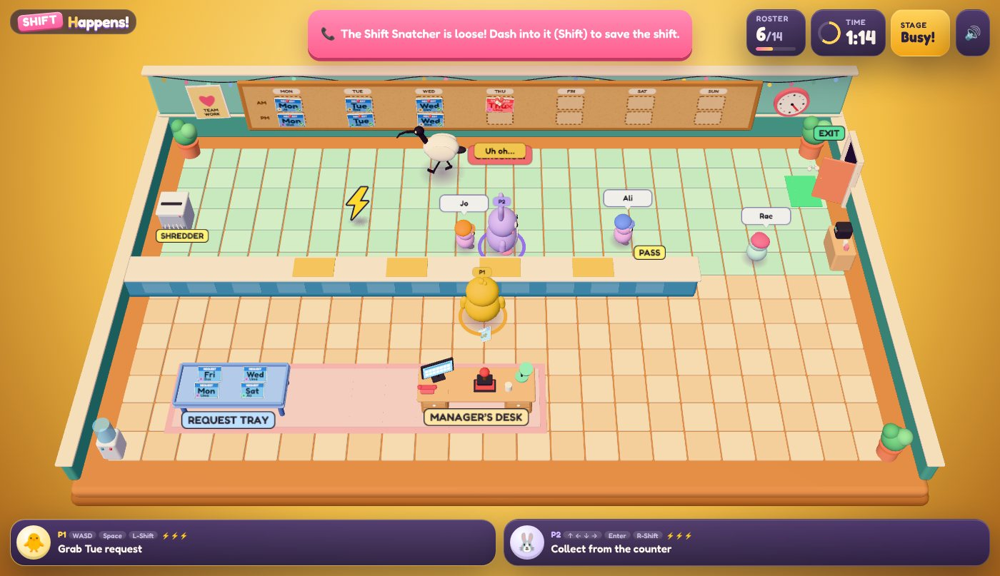

# Shift Happens!

Overcooked, but for rostering. Two to four helper critters (a duck, a bunny, a cat and a frog) live inside a rostering system. Employees keep sending in shift requests, and the helpers race the request cards through the system to fill all 14 shifts on the week's Roster Board in two minutes. Cancellations and a shift-stealing bin chicken keep un-filling it.

**[Play it now](https://vetematts.github.io/ShiftHappens/)** on a laptop or a phone.



Made for the Tanda Hackathon 2026 by [Matt](https://github.com/vetematts), [Edward Li](https://github.com/eli0118999), [Flynn Martschinke](https://github.com/flynnmartschinke) and [Harsha](https://github.com/hvarma029). Had fun? A ⭐ on the repo would make our day.

## How to play

| Card | What to do |
| --- | --- |
| 🟦 **Shift request** | Grab it from the Request Tray, hold the action button at the Manager's Desk to stamp it, pass it over the counter and pin it in its day's column on the board. |
| 🟥 **Cancelled** | A pinned shift wobbles for 3 seconds, then turns red when the worker cancels. Pull it off the board and drop it in the Shredder. A yellow open shift appears on the tray. |
| 🟨 **Open shift** | It's for one named employee. Their thought bubble flashes while you carry it: chase them down (they wander the office and slow you down if you brush past) and press action next to them to hand it over, then pin it. No stamp needed. |
| ⚡ **Dash charges** | Each critter has 3 dash charges and one refills every 9 seconds. Grab a ⚡ off the floor to refill one, or for a 4 second speed boost when you're already full. |
| 🐦 **Shift Snatcher** | A bin chicken sneaks to the board, steals a card and runs for the exit. Dash into it to make it drop the card, then pin it again. If it escapes, the shift becomes an open shift. |
| 🍌 **Slippery office** | Employees take breaks. One hurries to the water cooler for a drink and it springs a leak: a puddle spreads next to the Request Tray. Another stops to eat a banana and drops the peel. Walk or dash through either and you slip, fall over and drop your card. Standing still in a puddle is safe, puddles dry up after 22 seconds, and the Snatcher slips on peels too. Breaks come more often as the round speeds up. |

The board only takes an approved card, in an empty slot on the card's day. Rounds go Calm (0:00–0:40), Busy (cancellations and the Snatcher start) and Chaos (1:20–2:00, everything speeds up). The background music speeds up with each stage and again in the last 10 seconds. Fill all 14 slots with no red cards to win. The time left is your score. The end screen shows the finished roster with a **Copy roster** button, plus party awards for whoever pinned, stamped, passed, shredded and rescued the most, and a Banana Magnet award for whoever slipped the most.

| | Move | Action (hold to stamp) | Dash |
| --- | --- | --- | --- |
| Duck (Player 1) | WASD | Space | Left Shift |
| Bunny (Player 2) | Arrow keys | Enter | Right Shift or `/` |
| Cat and frog (Players 3–4), or any phone | Thumb stick | Action button | Dash button |

Playing alone? Press **Q**, or the swap button on a touch screen, to switch critters.

**Testing.** `node scripts/simulate.ts` plays rounds with bots and prints win rates. After `npm run build`, `node scripts/smoke.mjs` plays the build in headless Edge (Windows) or Chrome (Mac, Linux) and saves screenshots to `smoke-out/`. Add `?debug` to the address to get `shiftHappens.round()` in the browser console.

## Quick play or Roster my team

**Quick play** drops you into a two-minute week at a sample café.

**Roster my team** is for a real business, and takes four steps:

1. **Business.** Start from a café, dental clinic or hair salon, or from scratch.
2. **Roles and shifts.** Name up to four roles (dentist, assistant, reception…) and the two shifts in a day (AM and PM, or 8–12 and 1–5). Choose whether people can work both shifts in a day.
3. **Team.** Add each person with their role, the days they can work and how many shifts they want.
4. **Week.** Click how many of each role every shift needs, up to four people a shift.

It warns about places nobody can work and roles without enough shifts between them, and saves the team on that device. In the game your team sends the requests and covers open shifts. For now each needed shift is one card on the board, so shifts that need several people are simplified to one. Play it, then copy the finished roster from the end screen.

## Phones as controllers (Jackbox-style)

Like a Jackbox party game, the laptop or projector shows the game and phones become the gamepads. Nobody installs anything.

1. Open the game on the laptop and select the **Phones** tile on the menu.
2. A QR code and a four-letter room code appear. Scan the QR code with a phone camera, or select **Copy join link** to send the link instead.
3. Phones become the duck, the bunny, the cat and the frog, in the order they join. The menu ticks off each one as it connects, and each phone shows a lobby with its critter and who else is in. The cat and the frog walk into the office as soon as a third or fourth phone joins, even mid-round.
4. Like a Jackbox VIP, the first phone in gets **Everybody's in. Start!** while the others wait for it. Tap it when everyone has joined, or start from the laptop. A 3-2-1-Go countdown plays on the big screen and every phone, so everyone starts together. Each phone shows a thumb stick, an action button, a dash button, what its critter is holding and what the action button will do next.
5. Phones flash, and buzz on Android, when their critter stamps or pins a card or slips over, and when a shift is cancelled or the Snatcher appears. When the round ends, each phone shows that player's awards and tallies, with a **Play again** button.

A fifth phone waits and takes over a critter as soon as a phone leaves. If a phone leaves mid-round, its critter puts down the card it was carrying so nobody gets stuck. The keyboard keeps driving the duck and the bunny, so keyboard and phone players can mix.

**How it works.** The QR code opens the same GitHub Pages site with the room in the address (`#join-ABCD`). By default the laptop and phones talk through the team's small relay server (below), which works on guest Wi-Fi. With `?relay=off` they find each other through public Nostr relays using [Trystero](https://github.com/dmotz/trystero) and talk directly over WebRTC instead. Either way the laptop runs the whole game: phones send their stick and button about 20 times a second, and the laptop sends each phone its critter's status 5 times a second.

**Before a demo.** Test on the real Wi-Fi with real phones. Some venue and mobile networks block direct connections. If a phone stays on *Joining room…*, use the relay server below, put everything on one phone's hotspot, or fall back to the keyboard.

### Guest Wi-Fi? Use the relay server

Guest and venue networks often stop phones and the laptop connecting to each other. The relay in `server/relay.mjs` fixes that: everyone connects out to it (like visiting any website) and it passes the messages along. It keeps no game state, and if a connection drops, phones reconnect on their own and keep their seats.

Put it online once, free, on [Render](https://render.com):

1. Sign in to Render and choose **New → Web Service → Public Git Repository**, then paste `https://github.com/vetematts/ShiftHappens`.
2. Set **Root Directory** to `server`, **Build Command** to `npm install`, **Start Command** to `npm start`, **Region** to Singapore (closest to Brisbane) and **Instance Type** to Free. Create it.
3. When it says **Live**, open its address (for example `https://shift-happens-relay.onrender.com`). It should say *Shift Happens relay is awake*.

The game uses the team's relay (`shifthappens-c5ij.onrender.com`, set in `src/phone-link.ts`) by default, so the plain address works and the menu says *via relay server*. Add `?relay=another-host.onrender.com` to use a different relay, or `?relay=off` to go back to direct connections; the QR code and join link carry either along.

The game pings the relay as soon as the page opens, to start waking it. On demo day, still open the relay's address about five minutes early: a free Render service sleeps after 15 idle minutes and takes about a minute to wake. Leave the game open on the laptop and it stays awake.

To try the relay on one computer: `cd server && npm install && npm start`, then add `?relay=ws://localhost:8787` to the game's address.

**Testing with real phones locally.** `npm run dev` also listens on your network, and on `localhost` the QR code points phones at this computer's Wi-Fi address (the `Network:` line Vite prints) instead of `localhost`, which a phone can't open. The phones must be on the same Wi-Fi as the computer.

**Testing without phones.** Add `?link=local` to the laptop's address and select the **Phones** tile. Then open `index.html#join-CODE-local` in other tabs of the same browser, with the room code in place of `CODE`. The tabs talk through the browser instead of the network.

## Run it yourself

Use Node.js 22.13 or newer.

```sh
npm ci
npm run dev        # local server that reloads as you edit
npm run build      # static site in dist/
npm run preview    # serve the build locally
npm run typecheck
npm run lint
```

The office lowers its detail automatically on slower devices. Add `?quality=high` or `?quality=low` to the address to fix the detail level.

## How it's built

React and Vite for the page, Three.js for the 3D office, [Fredoka](https://fonts.google.com/specimen/Fredoka) for type, and no backend. The rules are plain TypeScript with no rendering, and the 3D world only reads the game state each frame, so gameplay can change without touching the graphics.

| File | What it does |
| --- | --- |
| `src/round.ts` | All the rules: the starting teams, request cards, stamping, pinning, cancellations, open shifts, the wandering employees and their breaks, puddles and banana peels, dash charges and ⚡ pickups, the Shift Snatcher, collisions, and every tuning number in `settings` |
| `src/office-world.ts` | The Three.js office, critters, cards, staff, the Snatcher, puddles and peels, board and effects |
| `src/shift-happens.tsx` | The game screen: input, HUD, menu, how to play, results, and the phone lobby |
| `src/team-setup.tsx` | The **Roster my team** steps: business, roles and shifts, team, week. Saved in the browser |
| `src/phone-link.ts` | Room codes, join links and the links to phones: peer-to-peer, through the relay, or same-browser |
| `server/relay.mjs` | The optional relay server for networks that block direct connections |
| `src/phone-controller.tsx` | The gamepad a phone shows after scanning the QR code |
| `src/play-qr.tsx` | QR codes |
| `src/sound.ts` | Sound effects, synthesised in the browser |

## Publishing

GitHub Pages publishes the game after every push to `main`. The same workflow checks types and lint on pushes and pull requests, without holding back the live game. It needs **GitHub Actions** selected once under **Settings → Pages → Source**. To republish without a new commit, open **Actions**, select **Publish Shift Happens** and run it from `main`.
